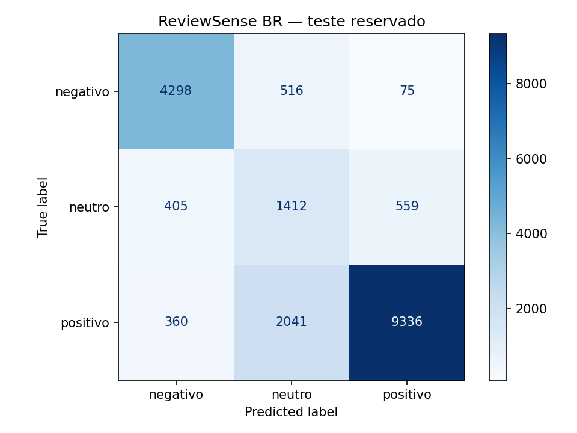

# ReviewSense BR

Brazilian Portuguese review analysis combining a trained sentiment classifier
with evidence-linked LLM synthesis.

- **Machine learning:** TF-IDF + logistic regression, trained and evaluated on B2W-Reviews01.
- **GenAI:** structured praise, complaint and action summaries using GPT-OSS 120B hosted by Groq.
- **Evaluation:** held-out classification metrics, offline contract tests and an exploratory review of a recorded LLM run.

The sentiment classifier was trained in this project. GPT-OSS is an external
pretrained model used through an API; it was not trained or fine-tuned here.

## Project links

- [Published sentiment model](https://huggingface.co/gimaciel/reviewsense-br-tfidf)
- [ML experiment](reviewsense_br.ipynb)
- [GenAI notebook](reviewsense_br_genai.ipynb)
- [Recorded GenAI execution](genai/README_GENAI.md)
- [Exploratory qualitative review](genai/QUALITATIVE_REVIEW.md)

## Recorded GenAI demonstration

A batch of **12 authored synthetic restaurant reviews** produced four praise
groups, four complaint groups and four proposed actions using
`openai/gpt-oss-120b` on Groq with prompt `reviewsense-evidence-v2`.
The run recorded **2.6581 seconds**, **1,005 input tokens** and **1,052 output tokens**.
These are observations from one run, not latency or quality benchmarks.

All 14 evidence excerpts match their cited input reviews. Qualitative inspection
also found scope generalizations, including plural delivery incidents inferred
from a single packaging complaint. The original report remains unchanged.
Citation integrity does not establish semantic accuracy. Independent human
review and evaluation on separate batches remain pending.

The demo uses Groq's Free plan subject to account quotas. No card or subscription
is part of the project setup; the API key is supplied through a secret or a hidden
prompt and is never included in these files.

## GenAI code and tests

`reviewsense_genai.py` contains the reusable schema, preprocessing, classification,
reference validation and Groq integration. `requirements_genai.txt` records the
dependencies from the uploaded execution. The original run recorded 16 offline
contract tests with no failures; the publication adds a regression test for
stringified finding objects. Tests use simulated API responses and do not score
LLM quality.

```bash
python -m pip install -r requirements_genai.txt
python -m unittest discover -s tests -v
```

For API execution, the notebook reads `GROQ_API_KEY` from the environment, Colab
secrets or a hidden prompt. ML training and GenAI synthesis use different data:
the former is evaluated on product reviews; the latter is demonstrated on a
small synthetic restaurant batch.

## Dataset and labels

[B2W-Reviews01](https://github.com/americanas-tech/b2w-reviews01), by B2W Digital,
contains product reviews from Americanas.com collected in 2018.
The dataset and this educational, non-commercial model use CC BY-NC-SA 4.0.
The original CSV and individual reviews are not redistributed in this package.

Labels are proxies derived from star ratings: 1–2 `negativo`, 3 `neutro`, 4–5 `positivo`.
They are not independent human annotations of textual sentiment. Only the review
text is used as a feature; the rating is used exclusively to derive the target.

## Preprocessing and experimental protocol

- Unicode NFKC normalization, whitespace normalization and lowercasing.
- Removal of missing or empty texts, invalid ratings, conflicting class labels
  for identical normalized texts, and repeated normalized texts.
- 126,674 usable reviews from 132,373 original rows.
- Stratified random 70/15/15 train/validation/test split; seed 42.
- Split sizes: 88,671 train, 19,001 validation, 19,002 test.
- TF-IDF: unigrams and bigrams, `min_df=3`, `max_features=40000`, `sublinear_tf=True`.
- Logistic regression: `class_weight='balanced'`, `max_iter=1000`, selected `C=0.5`.
- Selection from `C` values 0.5 and 2.0 by validation Macro-F1.
- Vocabulary fitting occurs within the training pipeline. After selection, the
  final pipeline is refitted on train + validation and evaluated on the reserved test set.

## Held-out test results

| Model | Accuracy | Macro-F1 |
|---|---:|---:|
| Majority-class baseline | 0.6177 | 0.2546 |
| TF-IDF + logistic regression | 0.7918 | 0.7230 |

| Class | Precision | Recall | F1 | Support |
|---|---:|---:|---:|---:|
| negativo | 0.8489 | 0.8791 | 0.8637 | 4889 |
| neutro | 0.3558 | 0.5943 | 0.4451 | 2376 |
| positivo | 0.9364 | 0.7954 | 0.8602 | 11737 |



Full scores, data hash, split sizes and configuration are recorded in `metrics.json`.

## Error analysis

The neutral class is the main weakness, with lower precision and F1 than the
negative and positive classes. The test confusion matrix contains 2,041 positive
reviews predicted as neutral. Overall, 3,956 of 19,002 test predictions were incorrect.

Exploratory review inspection showed mixed-sentiment excerpts and positive
language predicted as neutral. These observations do not establish the cause of
each error. Star-derived labels can disagree with the sentiment expressed in text.

In an authored demonstration, the complaint "A comida chegou fria e faltou uma bebida."
was predicted as neutral. This is a qualitative failure case outside the evaluated
product-review domain, not a restaurant benchmark.

## Local inference

The artifact `model.joblib` contains the fitted vectorizer and classifier.
The training Python version is 3.13.18; package versions are
recorded in `requirements.txt`. Load only trusted Joblib artifacts.

```python
import joblib
import pandas as pd

model = joblib.load("model.joblib")
texts = pd.Series(["Não recomendo o produto."])
texts = texts.str.normalize("NFKC").str.replace(r"\s+", " ", regex=True).str.strip().str.lower()
print(model.predict(texts.tolist()))
```

This repository distributes a scikit-learn artifact for local inference.

## Reproducibility

The companion notebook `reviewsense_br.ipynb` contains data acquisition,
preprocessing, training, evaluation and artifact export. Its installation cell
uses IPython syntax supported by Colab and Jupyter. The exported requirements
record the package versions installed during the corresponding run.

## Limitations

- Performance is measured on e-commerce product reviews, without restaurant or delivery validation.
- Ratings provide noisy sentiment proxies, especially for the neutral class.
- Exact duplicates are removed; near duplicates and shared product patterns may remain.
- The random split does not measure temporal or product-group generalization.
- Probability calibration, production monitoring and latency benchmarks are outside the current experiment.

## Planned experiments

- Comparison with a Portuguese Transformer under a documented evaluation protocol.
- Independent evaluation on appropriately sourced restaurant reviews.

Transformer comparison, independent restaurant-domain evaluation, a hosted interactive demo and multi-batch semantic evaluation remain planned work.
